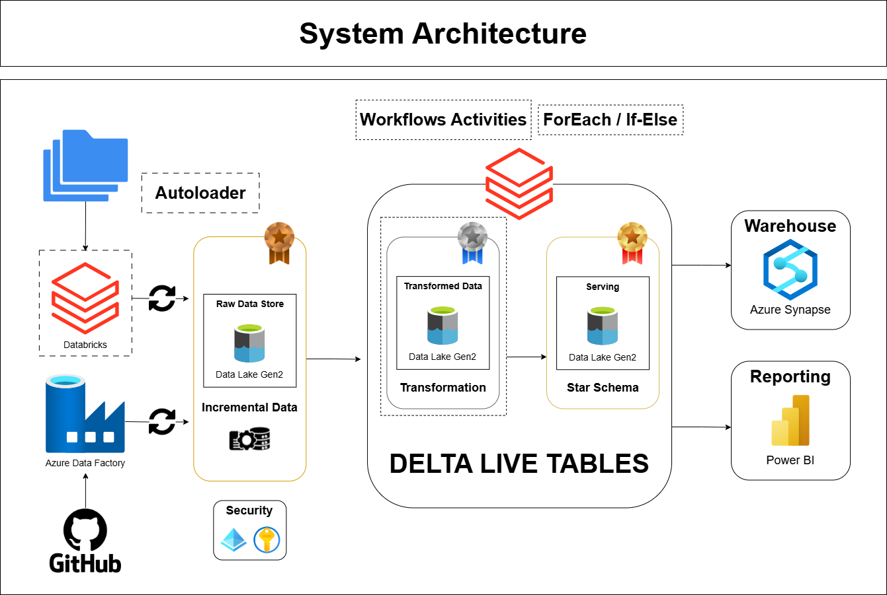

# ☁️ netflix-azure-data-lakehouse-pipeline

This project demonstrates an end-to-end data engineering pipeline using Azure and Databricks, following a Medallion architecture to process and analyze Netflix data.

## 📖 Project Overview

This project demonstrates an **end-to-end data pipeline** for processing Netflix data using **Azure and Databricks**. It follows the **Medallion Architecture** (Bronze, Silver, Gold) on **Azure Data Lake Storage (ADLS)** and utilizes **Azure Data Factory (ADF)**, **Databricks**, **Delta Live Tables**, and **Databricks Autoloader** for seamless data ingestion, transformation, and orchestration.  

---

## 🏗️ Data Architecture

1. **Data Ingestion (Bronze Layer)**
   - Source: GitHub repository containing Netflix data.  
   - Tool: **Azure Data Factory (ADF)** pipelines pull data from GitHub and load it into the **Bronze layer** on **ADLS**.
   - **Linked services** connect **GitHub → ADF** and **ADF → ADLS Bronze**.  
   - **Databricks Autoloader** is used to incrementally load new files into the **Bronze Layer**, reducing manual ingestion efforts.

2. **Data Processing & Transformation (Silver Layer)**
   - **Databricks Access Connector** links ADLS to Databricks.  
   - **Azure Databricks** processes raw data and applies cleaning & transformations.  
   - Data is stored as **Delta Tables** in the **Silver Layer**.  

3. **Data Aggregation & Analysis (Gold Layer)**
   - Transformed data is further aggregated in **Delta Live Tables**.  
   - **Unity Catalog** is used for data governance & organization.  
   - **Databricks Workflows** schedule and orchestrate jobs.  

---

## 🛠️ Technologies Used  
- **Azure Data Lake Storage (ADLS)** – Storage for Bronze, Silver, and Gold layers.  
- **Azure Data Factory (ADF)** – ETL tool for ingesting data from GitHub to ADLS.  
- **Azure Databricks** – Processing, transformation, and analysis engine.  
- **Delta Lake & Delta Live Tables** – Optimized storage & real-time transformations.  
- **Databricks Autoloader** – Automated and incremental ingestion of new data files.  
- **Unity Catalog** – Centralized governance for managing data assets.  
- **Databricks Workflows** – Job scheduling and orchestration.

---

🔑 Key Features

☑️ End-to-end data pipeline with Azure & Databricks.

☑️ Medallion architecture (Bronze, Silver, Gold) for structured data processing.

☑️ Delta Live Tables for real-time transformations.

☑️ Automated workflows & scheduling using Databricks Workflows.

☑️ Unity Catalog for centralized data governance.

---

## 📂 Folder Descriptions

| Folder                 | Description                                        |
|------------------------|---------------------------------------------------|
| `Azure/`              | ADF pipeline + linked services JSON files         |
| `Data/`               | Sample input data files                           |
| `Databricks_Notebooks/` | Databricks notebooks for transformation/analysis  |
| `Docs/`                | Architecture details                              |
| `Parameter_file/`     | ADF parameter files for dynamic configuration     |
| `Pipeline_Screenshots/`| Screenshots of pipelines, workflows, architecture |
